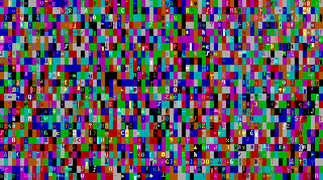
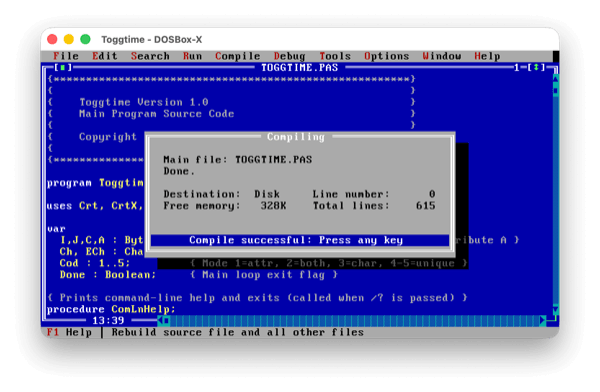
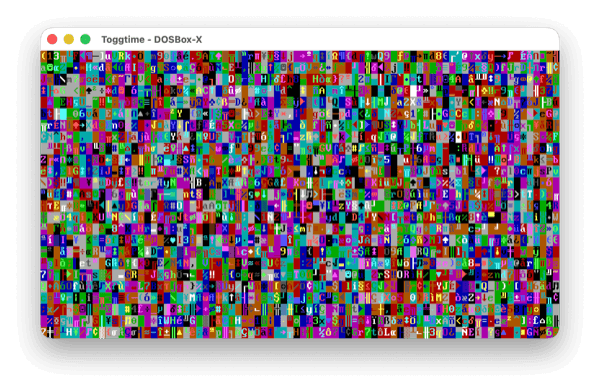

# Toggtime


Toggtime is a small DOS demo I wrote in October 1995 in Borland Turbo Pascal 7, while I was learning to program. I had just discovered that the 80×25 text-mode screen is really just an array of bytes at memory address `$B800` - two bytes per position, one for the character and one for the color attribute - and that Turbo Pascal's `absolute` keyword lets you map a typed array directly onto it. Instead of the standard Crt approach - `GotoXY` to move the cursor, `Write` to output a character - you just assign a byte to any screen position and it appears instantly.

<p align="center">
  
</p>

I built it to see that in action. It throws random characters and color attributes at video memory as fast as the CPU allows, and lets you switch modes to isolate what each byte does: colors only, characters only, both at once, or a single random pair frozen across the entire screen.

Thirty years later, in April 2026, I brought it back to life on a modern Mac via DOSBox-X. It still works.

## What it does

When you launch Toggtime, it starts filling the screen with random characters and color attributes. You can change the mode with single keystrokes:

| Modes | Controls |
|---|---|
| **A** - Attributes only | **P** - Pause |
| **B** - Both attributes and characters (default) | **H** / **Esc** - Toggle help screen |
| **C** - Characters only | **Q** - Quit |
| **U** - Unique attributes and characters | |

## Run it in your browser

<p>
  <a href="https://thehelloworldwriter.github.io/Toggtime/">
    
  </a>
</p>

The browser version runs the same DOS program in [js-dos](https://js-dos.com/), a DOSBox port for the web. Double-click the screen for full screen. After you quit with **Q**, type `TOGGTIME` at the DOS prompt to start it again.

Chrome and Edge can also install it as an app, and Safari can add it to the Dock or the Home Screen. It then opens in its own window, but still needs an internet connection.

## Download

<p>
  <a href="https://github.com/TheHelloWorldWriter/Toggtime/releases/latest">
    
  </a>
</p>

The ZIP contains the DOS executable, a short readme, and the MIT license. Run `TOGGTIME.EXE` in DOSBox-X or any DOS-compatible environment.

## Building and running

I build and run Toggtime using [DOSBox-X](https://dosbox-x.com/) on macOS, with a copy of [Borland Turbo Pascal 7.0](https://winworldpc.com/product/turbo-pascal/7x) downloaded from WinWorld:

1. Mount the project directory and the Turbo Pascal installation in DOSBox-X
2. Launch `TURBO.EXE` and set **Options > Directories** to point at the `UNITS\` path
3. Open `SRC\TOGGTIME.PAS`
4. Press **ALT+F9** to compile, **Ctrl+F9** to run

What surprised me was how familiar it all felt. Turbo Pascal was one of the first IDEs I ever worked in - along with QBasic and Turbo C++ - when I was learning to program for the first time. And here it is again: the same blue editor, the same compilation dialog, running inside a macOS window with traffic-light buttons. A different frame around a very familiar experience.

<table>
  <tr>
    <td align="center">
      
      <br><em>Compiling in Turbo Pascal on macOS</em>
    </td>
    <td align="center">
      
      <br><em>Running on macOS via DOSBox-X</em>
    </td>
  </tr>
</table>

To build from the command line instead, run `python scripts/build.py`. It compiles the program in [DOSBox Staging](https://www.dosbox-staging.org/) without opening the IDE, and checks that the result is byte-identical to the `TOGGTIME.EXE` in the v1.0.0 release. Set `DOSBOX` to the DOSBox Staging executable and `DOS_C_DIR` to the folder that DOSBox mounts as `C:`, with Turbo Pascal installed in it. The script looks for the compiler at `C:\BP\BIN\TPC.EXE`; set `TPC` if yours is elsewhere, for example `C:\TP\BIN\TPC.EXE`. With `--web`, it also rebuilds the browser version in `web/`, and with `--package`, it writes the release ZIP to `dist/`.

## Source layout

```
SRC/
  TOGGTIME.PAS          main program
UNITS/
  STDCHAR.PAS           character types and digit/hex constants
  CURSOR.PAS            BIOS INT 10h cursor + keyboard typematic rate
  CRTKEYB.PAS           keyboard input with extended-key handling
  CRTX.PAS              Crt extensions: attributes, windows, frames, sound
  VIAT.PAS              direct VRAM arrays mapped via the absolute keyword
web/
  index.html            browser version, running the DOS program in js-dos
  toggtime.jsdos        js-dos bundle with TOGGTIME.EXE, written by build.py
  manifest.webmanifest  web app manifest, for installing it as an app
  icons/                favicon and app icons
scripts/
  build.py              build, browser bundle and release ZIP
```

The five units are small and reusable on their own. They may eventually move into a shared Hello World Writer Pascal library.

## License

Toggtime is licensed under the [MIT License](LICENSE).

---

Made with ❤️ in Oradea, Romania
[https://www.thehelloworldwriter.com](https://www.thehelloworldwriter.com)
